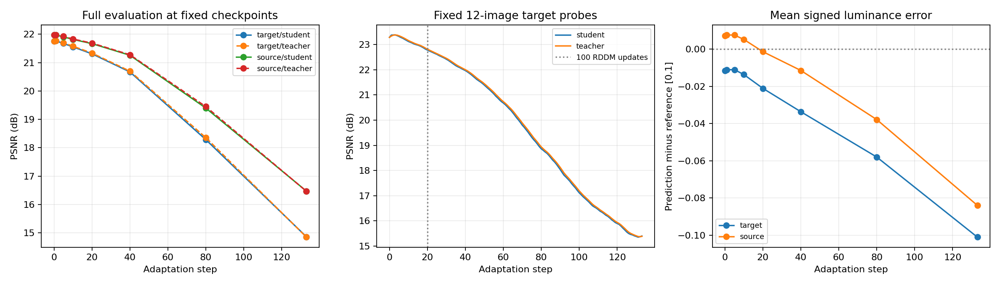

# UIEB 第二版适配诊断分析

> 归档说明（2026-09-17）：本文件保留所属阶段的历史内容和当时状态；当前进展请看 [文档导航](../README.md)。文中“待运行”等描述不代表今天的状态。

后续修订（2026-09-12）：单步真实更新结果已回传。第1、20、133步均改善当前raw；第20步同时损害固定目标观察集，Fisher缓解了部分跨图损失。以下机制链仍是假设，具体修正及下一步见 [单步更新诊断分析](../04_20260912_update_diagnostic/UIEB_BLUE_UPDATE_DIAGNOSTIC_ANALYSIS.md)。不能将本文理解为已证明三个检查点的梯度损害当前图。

依据：`experiments/UIEBblue_weaktostrong_NU2Net_diagnostic_v2` 回传记录。本文只分析已有实验，不修改算法、权重或数据划分。

## 1. 结论

本次严格模式、固定第一轮Fisher的诊断仍出现严重负迁移：133张目标集PSNR从21.760600降至14.864615 dB，131张下降；27张源验证集从21.972640降至16.472928 dB，25张下降。更准确的描述是跨图累积更新导致恢复能力持续漂移，同时输出逐渐偏暗；不是只在某一张图突然出错，也不是目标域指标差而源域能力保持不变。

目前最值得验证的机制链是：再退化产生明显的颜色分布变化 → 在再退化输入上优化两项高度同向的自监督约束 → 共享网络在真实raw上的输出漂移 → EMA教师跟随学生，伪标签不再提供独立的源模型约束。NU2Net的每通道极值归一化可能进一步放大裁剪与颜色变化的影响。前半部分有直接观测，模块间因果和各自贡献仍需受控实验，不能宣称已经找到唯一根因。

不建议先挑更强目标图、重分数据或重新训练源模型。应先验证上述链条。否则会同时改变任务难度和适配方法，丢失当前可比较的基线。

## 2. 证据是否可信

- 六个阶段状态完整；22张严格重复、观测开关、恢复重放验收通过。133步完整运行的前22步与验收控制轨迹相同。
- 133条适配记录、665条RDDM更新、268份学生/教师评价及46份数值对照齐全。
- Fisher保护位置恢复检查通过，未出现被保护元素未恢复的记录；执行成功且未触发非有限损失、梯度或参数停止检查。
- 第22步学生的严格/默认模式对照，在当步评价集合上最大逐图PSNR差约0.00005645 dB，平均输出绝对差约6.30e-7，最大像素差约8.60e-6。早期性能下降明显大于这些差异。
- 新运行最终目标PSNR为14.864615，第一轮为15.018862，差-0.154246 dB。两者都发生广泛退化，但不是按位相同的实验；不能仅凭22步对照排除133步后期数值敏感性，也不能完全分离固定Fisher之外的初始化/历史数值路径因素。

因此，数值非确定性确实影响严格复现，但目前不支持它是早期负迁移的主要解释。完成这些检查也不等于证明迁移后的全部算法语义无误。

## 3. 性能下降发生在什么时候

以下均为完整目标133张和完整源验证27张的学生评价，非固定小观察集：

| 更新步数 | 目标PSNR | 目标SSIM | 目标较源模型下降张数 | 源验证PSNR |
|---:|---:|---:|---:|---:|
| 0 | 21.760600 | 0.877917 | 0 | 21.972640 |
| 1 | 21.767239 | 0.878203 | 63 | 21.972343 |
| 5 | 21.675718 | 0.878367 | 78 | 21.908700 |
| 10 | 21.553721 | 0.877820 | 89 | 21.816034 |
| 20 | 21.310453 | 0.876261 | 96 | 21.669319 |
| 40 | 20.672292 | 0.871034 | 109 | 21.259156 |
| 80 | 18.287079 | 0.836859 | 122 | 19.398402 |
| 133 | 14.864615 | 0.745656 | 131 | 16.472928 |

第1步总体略有收益，第5步已低于源模型；不能说第一步必然有害。固定12张目标观察集的逐步曲线显示随后长期下行，后期退化加重，而非只在第20步EMA预热边界突然失效。

源域与目标域同时下降，说明不能用“弱/强域没有分开”来解释整个现象，也不能仅将其称为源监督训练过拟合。这里损失的是同一源模型在后续适配过程中的能力。

注意原自动报告 `DIAGNOSTIC_REPORT.md` 只汇总源验证4张和目标12张观察集：其中源域19.78→18.01 dB，不是全部源验证结果。完整源域实际上下降约5.50 dB。小观察集用于定位时间走势，不能代替完整集合汇总。

## 4. 各机制的证据与限制

### 4.1 教师跟随漂移，没有形成独立的源模型锚点

目标第20步学生/教师分别21.310453/21.336033，第80步18.287079/18.356446，最终14.864615/14.852121 dB。教师只是稍有延迟，最终没有保护住恢复质量。

实际学生原图分支停止梯度，反向来自再退化图分支；教师由学生EMA更新，并非永远固定在源模型。因此“两项损失都小”只说明两个自生成目标相互接近，不能保证接近reference。

三个已检查步骤的教师像素项/一致性像素项梯度范数比约为5.00、5.44、5.30；两者方向余弦约为1.00、0.969、0.994。教师感知项与一致性感知项也高度同向。这不支持“教师损失和一致性损失互相打架”作为这三步的主要解释，更符合相同方向被重复强化。只调低teacher_weight未必能移除漂移，因为另一项也使用会变化的学生输出作为目标。

限制：这些是更新前、完整候选参数上的分项原始梯度；不是Adam动量处理和Fisher恢复后的有效更新方向，也没有与真实监督梯度比较。不能根据范数比推算最终更新贡献恰好为5倍。部分余弦略高于1（最大约1.000465）是当前float32归约的数值误差，不能解释成超出1的真实夹角；后续精确分析应使用float64归约并报告误差，而非据此作细微方向判断。

### 4.2 再退化颜色偏移很强，优先检查是否成为不可靠训练输入

133张实际裁剪中，红通道均值低于0.01的raw为11张，再退化图为79张；再退化图蓝通道均值相对raw平均增加约0.14995（像素范围0～1）。这些是逐图浮点统计，不是截图估计。

第133步同一图的RGB均值：

| 张量 | R | G | B |
|---|---:|---:|---:|
| raw | 0.029608 | 0.392215 | 0.560824 |
| 再退化 | 0.000098 | 0.451642 | 0.775726 |
| 教师伪标签 | 0.274843 | 0.275320 | 0.251867 |
| 学生原图输出 | 0.272643 | 0.272529 | 0.251635 |
| 学生再退化输出 | 0.272855 | 0.261679 | 0.275721 |

预览保留了主体轮廓，但再退化图明显更蓝，学生原图输出出现暗褐色及边缘色彩异常。不能仅用颜色均值断定生成“错误”：生成更强退化本就是设计的一部分。问题在于如此严重的通道抑制是否仍保留可恢复信息、是否代表真实水下退化、是否产生有益更新；这些尚缺对照。

还需防止一个诊断误读：RDDM内部部分采样张量处在[-1,1]空间。通用统计的below_zero不能当成非法像素或截断比例，不能用“半数小于0”证明RDDM崩溃。真正截断比例应按该张量实际合法范围计算；现有min/max能证明部分越界，但不提供低于-1的完整比例。

### 4.3 输出整体偏暗是稳定现象

完整目标集平均亮度有符号误差（预测-reference）从-0.01151变为-0.10108，源验证从+0.00729变为-0.08402。与PSNR/SSIM同时恶化相结合，支持输出漂移，而不是单纯一个评价指标失灵。

跨图平均适配loss在1～20、21～40、41～80、81～133步分别约1.292、1.106、0.850、0.717。模型逐渐满足在线目标，但完整评价逐渐变差。不过这些区间图片不同，不能把该统计当作固定样本优化收敛曲线；也不能据此宣布“损失函数必然错误”。

### 4.4 NU2Net tail与裁剪上下文是放大因素候选

133步学生两路前向共266次，全部触发原实现的tail归一化。代码是每张图、每通道按空间min/max重新缩放，并非普通clamp。它会使一个区域的输出依赖该通道其他位置的极值；这与水下颜色恢复及跨输入一致性可能存在耦合。

第1、20、133步，更新前“裁剪输入输出”与“完整图输出对应区域”的MAE分别约0.01788、0.03268、0.01951；同次更新引起的完整图对应区域MAE仅约0.00273、0.00072、0.00125。上下文差异大于单次参数更新扰动，应检查训练视图到完整图的迁移。

但所有前向始终触发归一化，不能归因为某一步开关突然切换；上下文差异也可能来自InstanceNorm、卷积边界等，不能全部算在tail上。直接换tail会改变源模型输出协议，不能当作保持原模型的无害修复。

### 4.5 Fisher工作正常，但参数保护不等于功能保护

记录未发现受保护参数恢复失败。保留60%参数并不保证其余参数变化不会改变整个网络功能。记录中的恢复后更新范数仍非零，持续累积足以带来漂移；不能因最终效果差就宣布Fisher恢复没执行。

下一步应测量恢复前后真实监督诊断损失变化，以及有效更新相对于源模型的距离，而不是先提高比例、去除偏置或修改top-k。当前尚未证明Fisher选择适合UIE。

### 4.6 RDDM EMA时序需要检查，但不是已证实的首次故障点

RDDM的EMA是独立于学生教师EMA的另一个机制。日志显示update_every=10、update_after_step=100，并不是每一次在线子更新都同步采样模型。第一张图虽进行了5次训练，EMA权重只在第一次发生变化；跨图延迟值得检查。

第20步已累计100次子更新，但性能在第5步就下降。因此“跨过100次预热边界导致全部失败”不成立。后期EMA与在线参数距离增长说明存在滞后，距离本身不能证明采样质量不好；需要同条件下在线/EMA生成图及下游更新对照。

## 5. 对原先观点的修正

1. 弱域和强域的源模型PSNR接近，不能推出划分失败。PSNR混合了场景内容、reference风格、源模型能力和退化难度；当前诊断未检验退化分级效度。因模型在同一目标集适配后显著变差，优先解释更新过程，不按结果挑更难图片。
2. 源域21.97 dB不能单独证明NU2Net能力不足；需同划分、同训练预算、同评价协议的其他模型/训练对照。本次已证明适配会额外损坏一个可用源模型，提高源基线可能有价值，但不是当前问题的替代解释。
3. 131张下降强烈支持当前配置失效，但不能仅据此认定DCTTA理论本身错误，或认定某个迁移代码bug。此次定位到持续漂移与多个机制线索，仍需要因果干预。
4. 仅换随机种子、提高Fisher容差或追求位级复现不足以解决已观察到的退化。22步数值对照已把早期主要怀疑转向更新目标与生成输入。

## 6. 下一步：先做最小因果诊断，再改方法

### A. 利用现有保存状态，补齐单步有效更新证据

优先检查第1、20、133步，必要时增加80步；在程序机读取已有浮点张量和相应更新前状态，不重新训练源模型。恢复前置优化器状态需要从已存完整边界重放，不能仅加载学生权重后新建Adam冒充原更新。

记录：raw/ref对应裁剪、源模型/当前学生/教师输出的诊断PSNR和有符号RGB误差；RDDM合法范围外比例、通道零值比例与空间结构；原始分项梯度及其在Fisher未保护子空间的方向；实际Adam更新和Fisher恢复后的更新方向；更新前、Adam后、恢复后真实raw与再退化输入的离线监督误差。

reference仅用于只读诊断与梯度方向比较，不能用于在线损失、门槛、权重选择。分项方向使用float64归约。由此区分“原始目标方向有害”“Adam历史动量造成方向变化”“Fisher投影改变方向”和“裁剪目标改善但完整图变坏”。

### B. 以相同初态、顺序和Fisher做两项独立短程干预

- **固定源教师对照**：固定伪标签教师为源模型，其他设置保持。与严格控制比较是否抑制源域和目标域共同漂移。这会同时改变RDDM训练用伪标签，故能验证整个教师反馈路径，但不能单独归因于teacher_weight；若改善，再用保存的再退化输入隔离损失端影响。
- **再退化输入对照**：重放固定在线输入/状态时，用raw替代再退化图，其他目标和状态保持对应条件，检查实际更新及短程趋势。此时原图一致性项在更新前趋于零，属于诊断干预，不是公平的最终算法性能比较。若异常消失，再比较受限再退化与原RDDM，而非直接宣布不需要退化生成。

两项先分别做，避免同时改教师、生成器、tail与学习率后无法归因。建议先覆盖既有22步；若区分不清再延长到40步。目标reference不作为提前停止或挑模型的依据。无需再重复完整无干预133步。

### C. 有证据后再定义UIE算法变体

可能方向包括源教师锚定、约束颜色和结构保真的退化生成、限制可更新参数/单步漂移，以及处理归一化和裁剪的耦合。每一项都应标明是算法变体或训练协议变化；改tail须重新建立匹配源模型与基线。保留当前DCTTA迁移版本作为对照。

本次目标reference已用于诊断；未来用这些结论选择方法/超参数时，应将当前目标集视为开发集，另用未参与选择的数据验证最终改良效果。

## 7. 产物与边界

分析汇总：项目根目录 `tmp/v2_analysis_raw.json`、`tmp/v2_events_summary.json`；完整性核验 `tmp/v2_return_completeness.json`。图表由回传JSON生成，未覆盖原自动诊断报告。

现有证据足以判断当前配置不适合继续作为有效TTA方案，也足以确定下一步重点；尚不足以量化每个模块的因果贡献。大型中间张量和恢复状态仍在程序机，下一步优先在那里追加只读诊断，不要求回传整个大型目录。
