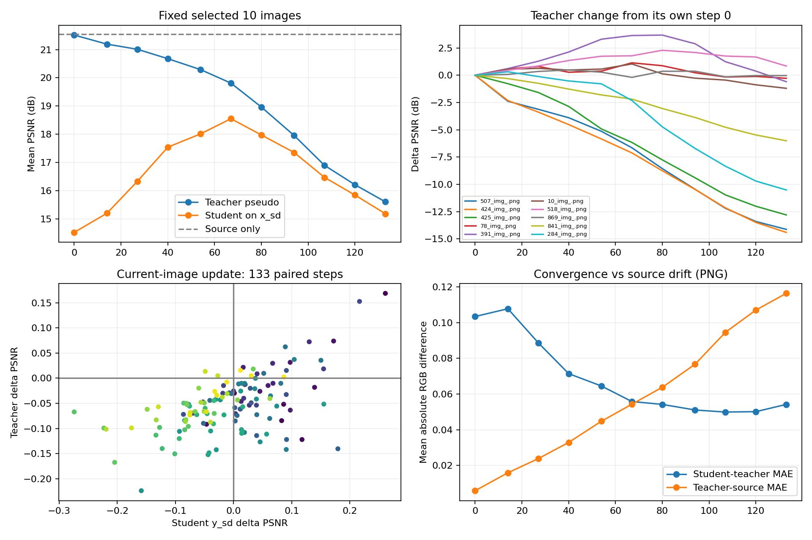
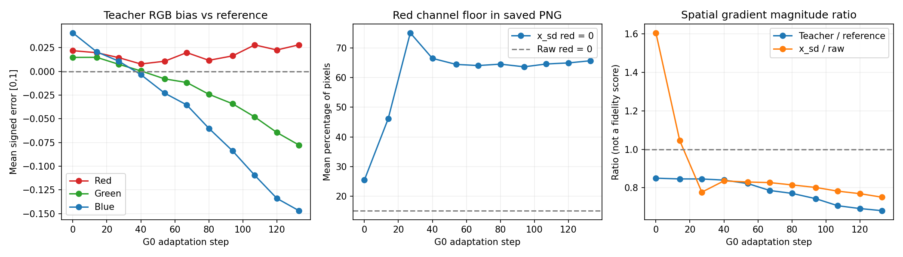
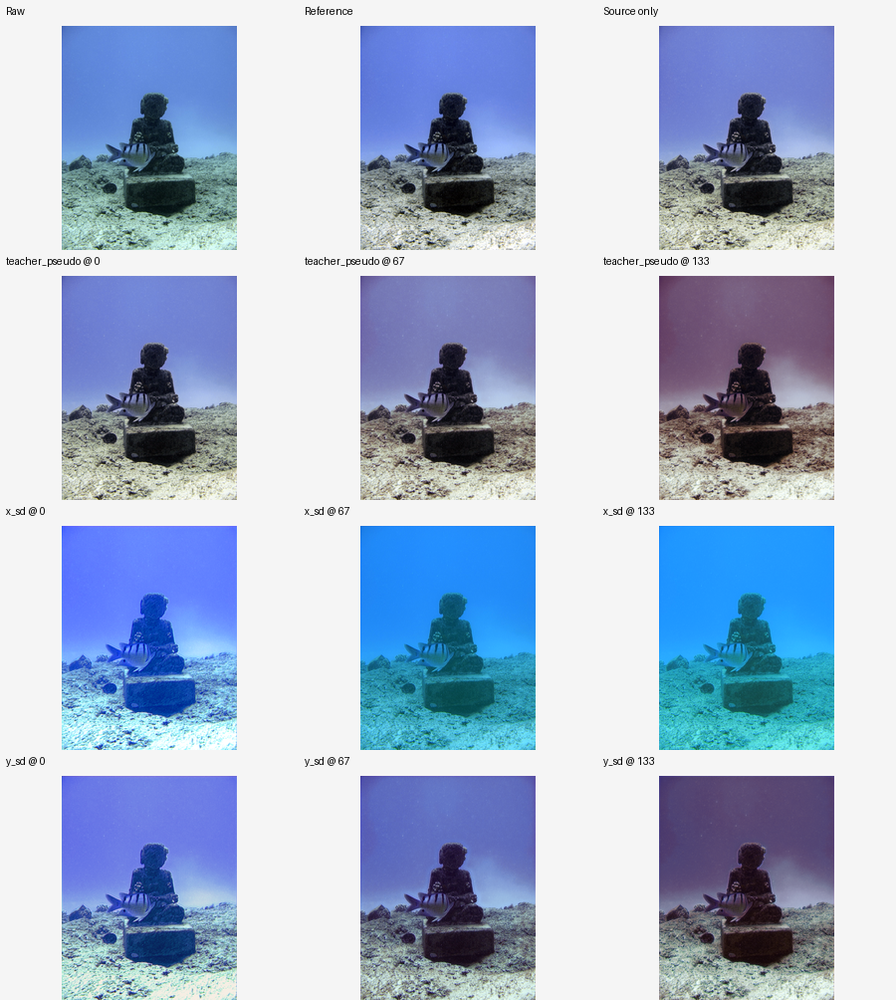

# G0 整图诊断回传：教师漂移、颜色信息损失与跨图负迁移

> 归档说明（2026-09-17）：本文件保留所属阶段的历史内容和当时状态；当前进展请看 [文档导航](../README.md)。文中“待运行”等描述不代表今天的状态。

## 1. 结论及证据等级

这次结果确认：教师八视图伪标签确实随适配发生系统性退化；再退化路径存在强烈的颜色分布改变，且红通道大面积归零也出现在原 G0 真正参与训练的浮点图块中。结合既有 G1/G2/G3 干预，最值得优先验证的机制是：再退化颜色信息受损，使学生学习的补偿偏离真实 raw 的需要；学生偏移经过 EMA 回流到教师，移动伪标签又继续影响学生与生成器，最终形成累积的不稳定反馈。

但目前不能把“红通道归零”认定为唯一根因，不能认定生成器某一行代码错误，也不能把 y_sd 当成直接写入教师的图像。教师更新的是学生参数的 EMA；x_sd/y_sd 通过损失和学生参数间接影响教师。

| 判断 | 证据等级 | 依据 |
|---|---|---|
| 教师伪标签随更新变差 | 已直接观测 | 固定10张快照、133次同图更新前后配对 |
| 再退化造成红通道严重压低/归零 | 已直接观测 | 整图PNG及原G0浮点训练统计交叉验证 |
| 学生教师越来越一致，不代表恢复质量提升 | 已直接观测 | 一致性差异下降、教师偏离源模型、参考PSNR下降同时存在 |
| EMA反馈是严重退化的重要干预点 | 既有干预支持 | G1保留再退化、只固定教师即可大幅缓解 |
| 过强颜色再退化诱导过度校正并被EMA放大 | 优先机制假设 | 本次颜色证据、时序与既有路径干预相容；尚未单独控制颜色失真 |
| 单纯分辨率/显存修复造成失败 | 不受本次证据支持 | 全133步原G0轨迹匹配，大小图都失败 |

## 2. 完整性与评价口径

- status=complete；133步，995张PNG，752行指标，实际回传约1.011 GB。
- 核验995张图片及4个状态引用文件，共999个文件哈希，无缺失或差异。
- 133步损失、完整状态哈希逐项匹配原G0轨迹，样本顺序一致；入口代码哈希也匹配。这里是核对回传记录，没有在本机再次执行CUDA重放。
- 本地原图/reference的133组文件内容哈希匹配清单。
- 对752个保存输出重新计算PNG PSNR，未发现超过1e-5 dB的差异或尺寸错误。浮点PSNR与PNG PSNR的平均绝对差0.000517 dB，最大0.007438 dB，远小于本次多dB退化。
- 不新增 x_sd 的PSNR；对其进行颜色、边界值和结构统计。所有图像统计保持[0,1]范围，不逐图自动调整对比度。

必须区分三种范围：

1. 全目标最终学生在raw上的评价：使用旧G0统一终态，133张。
2. online：每一步当前图片的额外整图诊断，更新前后使用同一未量化x_sd；不同步骤的图片和模型状态不同。
3. snapshots：10张固定图片跨11个阶段；这些样本按已知好坏结果和分辨率挑选，适合解释机制，不代表总体平均或无偏测试集。

整图x_sd是当前生成器额外采样的结果，不是当次训练裁剪放大；阶段0的生成器尚未经过目标适配。诊断注意力分批只影响额外推理，真实适配轨迹完全沿用原G0。

## 3. 教师确实漂移，而且在学生暂时变好时已经开始

### 3.1 固定10张图的共同轨迹

| 更新数 | 教师伪标签PSNR | 学生y_sd PSNR | 解释 |
|---:|---:|---:|---|
| 0 | 21.5153 | 14.5205 | 源教师基本保留源表现，未训练生成器的输入很难 |
| 27 | 21.0117 | 16.3307 | 学生对生成图提高，教师已开始下降 |
| 54 | 20.2907 | 18.0121 | 两者差距收窄，但教师继续损失 |
| 67 | 19.8124 | 18.5512 | y_sd阶段均值最高，不是可用的测试选模规则 |
| 80 | 18.9634 | 17.9738 | 学生和教师同时下降 |
| 107 | 16.8964 | 16.4702 | 后期已严重偏移 |
| 133 | 15.6037 | 15.1844 | 接近彼此，但偏离参考图 |

教师均值从自身第0步下降5.9117 dB。10张中9张最终低于自己的初始教师，其中507、424、425和最大图841的10个区间均下降；小图284有9个区间下降。即使不比较source_only，也能确认真实教师漂移。

y_sd的14.52→18.55→15.18表明“生成图恢复变好”可以只是暂时适应该生成分布，并未同步保留真实输入能力。它不是固定输入下纯学生能力的曲线，因为每阶段的生成器也在变化。

### 3.2 同图、同x_sd的133次更新

| 配对变化 | 次数 |
|---|---:|
| 教师变好、y_sd变好 | 18 |
| 教师变好、y_sd变差 | 2 |
| 教师变差、y_sd变好 | 51 |
| 教师变差、y_sd变差 | 62 |

教师113/133次下降，平均每次-0.05151 dB、中位数-0.05273 dB；y_sd有69次改善、64次下降，均值-0.00459 dB。两者不必同向。因此不能用“这一张y_sd看着改善了”判断本次更新安全。

这些单步变化对应不同图片，不能将它们简单求和解释为某一固定图片累计下降的dB。

### 3.3 早期与后期已经是两种状态

| 步骤区间 | y_sd改善次数 | 教师下降次数 | y_sd平均单步变化 | 教师平均单步变化 |
|---|---:|---:|---:|---:|
| 1–27 | 25/27 | 19/27 | +0.06117 | -0.01935 |
| 28–54 | 19/27 | 22/27 | +0.03727 | -0.03764 |
| 55–80 | 17/26 | 25/26 | +0.01023 | -0.07468 |
| 81–107 | 3/27 | 26/27 | -0.08066 | -0.08110 |
| 108–133 | 5/26 | 21/26 | -0.05216 | -0.04544 |

前期局部拟合收益与教师损害同时发生，后期局部收益也消失。最危险的是累积反馈，不像一张异常图片导致的一次性故障。最差当前图教师更新是第67步488_img_.png，-0.22389 dB；但不能据此把该图认定为全局根因。

## 4. x_sd有明确颜色异常，并且真实训练输入也存在

### 4.1 全图观察与颜色统计

10张固定图，第133步x_sd平均RGB为[0.0377, 0.5323, 0.8265]，相应raw为[0.1561, 0.4721, 0.6458]。红色被显著压低，蓝绿占比增加，视觉上普遍更青蓝。

第133步，10张x_sd的红通道平均65.66%像素在PNG中为0，raw仅15.15%；蓝通道平均39.60%像素为255。红通道标准差约为raw的29.63%。全133张online诊断中，104张红通道超过一半像素为0，平均零比例72.44%。

PNG边界值可能包含极低/极高浮点值被量化的影响，因此以上数字本身不能精确定位模型内部截断位置。

### 4.2 原G0浮点训练日志提供更强交叉证据

读取旧run/steps.jsonl中student_before.raw与student_outputs.regenerated的浮点统计：

| 指标 | 原始raw图块 | 真正送入学生的再退化图块 |
|---|---:|---:|
| 红通道中位数精确为0的图块 | 11/133 | **103/133** |
| 平均红通道强度 | 0.11296 | **0.02618** |
| 平均绿通道强度 | 0.42331 | 0.45668 |
| 平均蓝通道强度 | 0.56636 | **0.71631** |

数据范围非负，所以红通道中位数精确为0意味着至少一半像素红值为0；再退化的红均值比raw低约76.8%。另有12个再退化图块蓝通道中位数精确为1。

因此，严重通道压缩不是新诊断的PNG量化、整图尺寸或分批注意力造成的假象，而是原训练已存在的现象。本机使用的是回传浮点统计，不是重新加载缺失的逐步训练张量。

### 4.3 这意味着什么，不意味着什么

这类输入保留了大量物体位置与轮廓，却进一步减少本来就不足的红色信息。让学生从这样的输入恢复移动教师的颜色，需要更强的颜色补偿；它是否能迁移到相对温和的真实raw，是当前最关键的目标错配问题。

第133步，x_sd绿/蓝通道与raw的空间相关性仍约0.983/0.942，不能说生成器完全破坏了场景或生成无关内容。但红色信息和对比度明显受损，也不能将它视作“只加一点可逆噪声”。

阶段0的蓝通道平均约66.89%达到PNG上界，图像有明显噪声、边缘纹理变化；这只是未在线训练的生成器状态，不足以证明整个运行都由初始化问题引起。

源码确认：训练RDDM时，x_start=raw、condition=教师伪标签；采样时condition换成raw。它符合当前再退化设计，并非本次发现的参数交换bug。但当raw已强烈偏蓝、生成训练对也在随教师漂移时，从伪标签条件迁到raw条件可能继续加重退化。这个机制值得验证，不能未经对照直接翻转训练方向。

## 5. 输出的主要变化是颜色与亮度漂移，但不止全局色偏

逐张检查了10张图的raw/reference/source_only及0、67、133阶段的三类输出。507、424的蓝色水体逐渐偏紫褐；841出现明显暗化；284的小图也暗化并改变水体和沙地颜色。物体主体仍可辨认，并未普遍变成无关内容。

10张教师输出相对reference的平均RGB有符号偏差：

- 第0步：[+0.02184, +0.01475, +0.04062]。
- 第133步：[+0.02804, -0.07765, -0.14685]。

最明显的群体变化是绿、蓝通道被压低，而不是红色全都暴增。紫褐观感可以由绿/蓝下降造成，不能只凭外观说“模型在过量补红”。教师平均亮度偏差由+0.01812变为-0.06018，也支持整体变暗。

将每张图的MSE严格分成“每通道全局均值偏差平方”与“去掉均值后的残差”后，教师从0到133新增MSE中约47.1%来自前者、52.9%来自后者。这说明只做全局白平衡或亮度平移不能解释/修复全部误差；剩余部分也可能包含空间不均匀颜色、局部对比度，不应全称为结构破坏。

教师空间梯度幅值/reference的比值从约0.850降到0.681；x_sd梯度/raw从初始1.605降到最终0.751。它与早期噪声/纹理增强、后期对比度和细节减弱相容，但梯度幅值不是独立画质分数，暗化也会使其下降。

## 6. 损失下降可能掩盖“共同偏移”

原G0真实图块适配总loss，前27步平均1.2674，最后26步平均0.6825，降低约46.1%；与此同时教师指标大幅下降。不同区间图片不同，所以loss均值不是固定数据的优化曲线，但固定10张的一致性比较补足了这一点：

- y_sd与教师伪标签的PNG MSE：0.02117→0.00498，下降约76.5%。
- 教师与source_only的PNG MAE：0.00590→0.11635，约增至19.7倍。
- 教师相对reference的固定10张平均PSNR：21.5153→15.6037。

双方越来越接近，却一起远离初始可靠解。当前一致性目标没有单独保证对真实参考的改善。这是输出趋向同一偏色方向，不意味着所有图片都输出相同常量。

代码和旧日志还显示两个缺少纠偏机制的环节：

1. confidence在133步全部为1；现实现没有对不可靠伪标签/严重退化区域降权。八视图均值能平均变换差异，不能自动判断系统性色偏是否正确。
2. teacher_weight=5时，loss_t在各区间约占总loss的83.3%。教师颜色一旦偏移会继续成为强约束；这是损失值占比，不是梯度贡献或根因百分比。教师与学生raw输出的逐通道均值差平均仅0.00547，说明它们在这一粗粒度指标上很接近，但不能据此说二者逐像素完全相同。

教师EMA为0.45×旧教师+0.55×当前恢复后学生。连续10次更新后，最初教师参数的直接系数是0.45^10≈0.0003405；这不表示学生中所有源知识消失，但表明EMA本身不是一个长期固定源锚点。这里提出的是结构性风险，不是EMA实现错误。

## 7. 与跨图干扰、大小图和“好样本”的关系

### 7.1 单图有收益，其他图片仍可能受损

与旧G0固定12张观察集逐步评价配对：133步中128步使观察集均值下降；其中64步当前图y_sd却提高，17步当前图教师伪标签也提高。观察集可能含当前样本，所以不能把它称为严格的“其他全部图片”；但当前图改善不能保证固定集合改善已经十分明确。

这与上一轮真实第20步诊断一致：当前raw整图改善，但固定观察集下降。它支持跨图参数干扰，而不是“每次梯度都立即让当前图片变坏”。

本次online记录只额外测教师与生成输入上的学生，没有每一步当前学生raw输出的完整前后记录，因此不能据y_sd替代raw评价。

### 7.2 分辨率不支持作为首要根因

最大图841教师从19.7184降至13.7112，最小图284从28.4645降至17.9502；两端均明显退化。

全133张原G0终态相对source_only平均-6.8960 dB，131张下降。面积与PSNR变化的Spearman相关约+0.226，较大图片并没有呈现更严重下降。探索性模型同时纳入源PSNR和log面积后，标准化源PSNR系数约-2.480 dB，log面积约-0.111 dB；这只是该次运行的描述性结果，不是显著性检验或因果识别。

源PSNR与最终变化的相关约-0.844，但变化本身包含减去源PSNR，存在数学耦合与改善空间差异，不能拿相关系数证明“源效果好导致退化”。更可靠的事实是：本来已接近参考的507、424、425被明显损坏，缺少保留好结果的机制。

### 7.3 少数改善样本并不否定整体漂移

- 518：原最终学生对raw仅+0.8122 dB，教师伪标签相对自身初态+0.8421 dB；图像也确实发生向较暗/较暖方向的变化。其reference和source_only原本差别较大，某种共同偏移可能偶然更贴近该reference，不能外推通用提升。
- 869：原最终学生raw较source_only+0.1115 dB，但教师八视图伪标签较自身初态反而-0.03325 dB。说明“好样本”标签只指既定指标/模型，不代表其所有分支都提高。
- 78：教师起终PSNR只变化-0.2832 dB，但图像颜色和明暗变化明显。PSNR接近不等于输出稳定，更不等于伪标签没有漂移。

另一个统计陷阱：固定10张教师的平均PSNR到第67步下降，但平均MSE从0.01557略降到0.01399。dB的非线性以及不同样本初始误差造成这种并存；报告必须保留逐图分布，不能把任何一个均值当作“每张图都在变坏”。

## 8. 与G1/G2/G3合并后，根因定位到哪一步

原全目标结果仍为：source 21.7606，G0 14.8646，G1固定教师21.8745，G2 raw第二路21.2458，G3组合21.8697 dB。

G1保留生成路径却消除了严重崩溃，说明再退化存在不自动意味着必然崩溃；但固定教师也同时稳定了RDDM训练条件和学生教师目标，其总效应不能再拆成纯粹的一项。

G2/G3因两路raw相同而loss_s=0，因此不能用G2直接证明“生成图质量”就是全部原因。两组同时改了有效一致性目标。G1/G2/G3更新幅度也不同，尚无严格等范数对照。

目前最合理的工作假设是：

> 再退化进一步压缩颜色信息、增加蓝绿偏移 → 学生在这种输入上学习移动目标下的颜色补偿，部分更新伤害真实raw/其他图片 → EMA吸收学生偏移，教师伪标签暗化和色偏 → 教师继续影响生成器训练条件与学生损失，使偏移累积。

其中“真实训练颜色压缩”“教师漂移”“损失与参考表现分离”“固定教师干预有效”都有证据；“哪种颜色压缩通过哪条梯度造成多少损害”仍是待验证环节。这是比只说EMA或RDDM有问题更具体的定位，但不是单一根因已经被完全证明。

NU2Net的整图/图块上下文及norm tail可能参与，但本次没有逐步记录tail触发或其干预；Fisher/Adam亦有旧证据显示某些步骤改善当前图、缓解部分跨图损害。不能因为仍然失败就直接删除这些组件。

## 9. 下一步优先级：只围绕一条假设验证，不重跑已有组

不建议立即改整套网络、取消全部一致性、扩大随机搜索或把第67步当成最终最佳模型。现有target reference已参与诊断和选图，不能再用这些选择后的结果宣称无偏泛化收益。

若下一步仍优先验证根因，最有针对性的是“降低再退化颜色信息损失，保留原EMA与两个损失”的一个预先固定干预，并与现有G0比较；先在选定状态检查真实训练图块的通道统计、当前raw和固定观察集的前后变化。若干预减轻红通道归零同时减轻真实raw/教师退化，才加强该因素的因果解释。

具体混合/约束强度需预先固定，不用目标reference搜索。即使结果改善，也要说明它同时改变了输入难度和更新幅度，不能直接宣称红通道单因素已完全隔离。必要时再补等更新量对照，而不是现在一口气增加许多组。

若目标转为实用改良，已有G1是保留再退化机制的更合适起点；本次不需要重跑G1来证明它有效。固定源锚点/受限教师更新值得优先于无条件EMA反馈，但尚未在本次实施。

本轮只分析回传数据，没有修改算法或启动新的训练、适配实验。

## 10. 可复核附件

- [核验结果](visual_analysis/audit.json)
- [133次更新前后配对](visual_analysis/online_paired.csv)
- [10张图片轨迹摘要](visual_analysis/sample_trajectories.csv)
- [全133张终态与尺寸](visual_analysis/full_target_factors.csv)
- [整图颜色与结构统计](visual_analysis/image_statistics.csv)
- [243张x_sd颜色统计](visual_analysis/xsd_color.csv)
- [真实训练浮点图块交叉证据](visual_analysis/training_crop_evidence.json)
- [误差分解](visual_analysis/bias_decomposition.json)

10张联系表分别为 [507](visual_analysis/contact_507_img_.png)、[424](visual_analysis/contact_424_img_.png)、[425](visual_analysis/contact_425_img_.png)、[78](visual_analysis/contact_78_img_.png)、[391](visual_analysis/contact_391_img_.png)、[10](visual_analysis/contact_10_img_.png)、[518](visual_analysis/contact_518_img_.png)、[869](visual_analysis/contact_869_img_.png)、[841](visual_analysis/contact_841_img_.png)、[284](visual_analysis/contact_284_img_.png)。均按同一列顺序对齐0、67、133阶段；预览缩放只用于排版，统计使用原分辨率。
