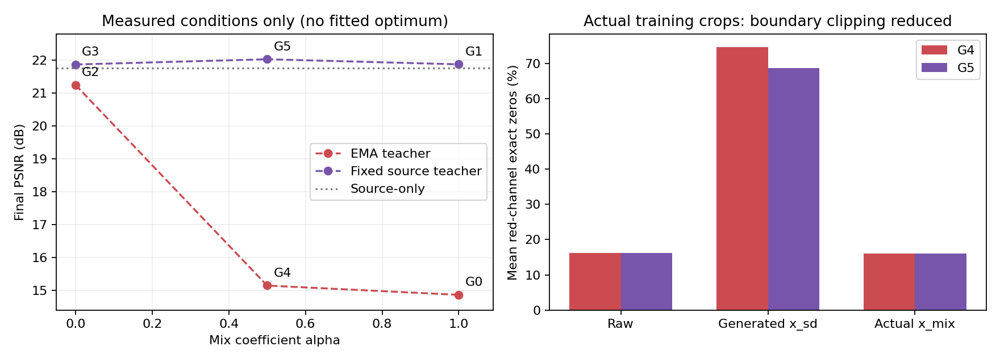
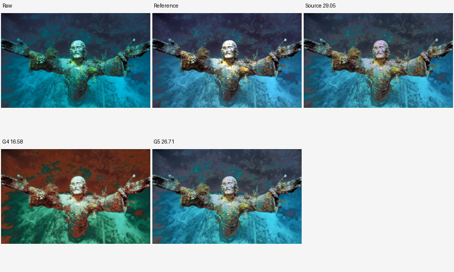
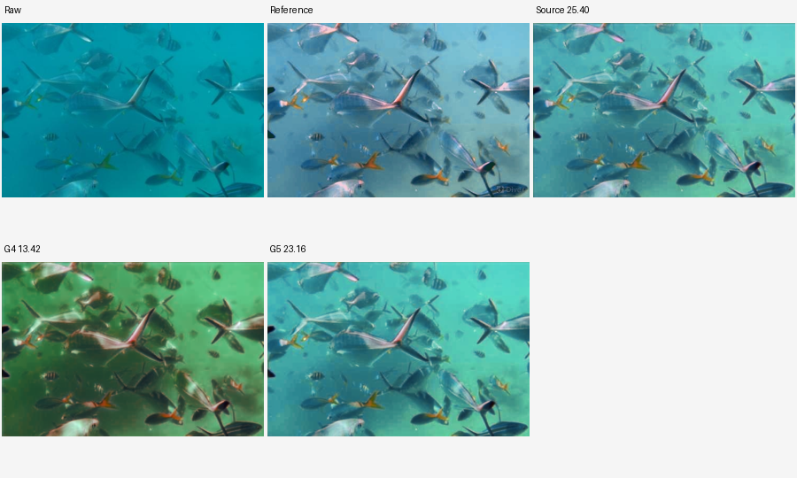
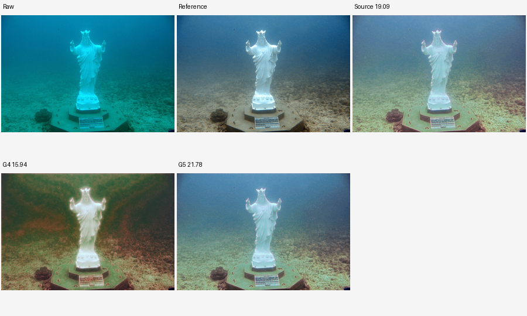
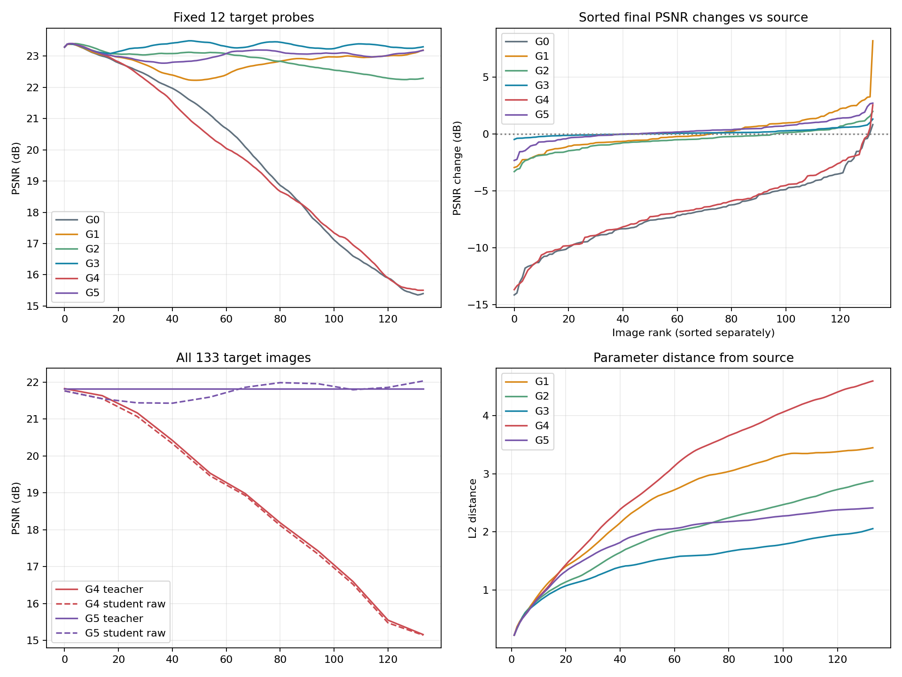

# G4/G5回传综合分析：强度控制有效，但没有修复EMA反馈失稳

日期：2026-09-18。综合首轮、strict v2、单步更新诊断、G1/G2/G3路径对照、G0整图诊断和本轮G4/G5结果。只分析已完成实验，不修改算法或重新训练。

## 1. 核心结论与需要修正的判断

本轮同时得到了一个可用的改良方向和一个明确的反例。

- **G5（固定教师、α=0.5）是当前六组中目标平均PSNR最高的变体**，收益比G1更普遍，源能力损失明显减轻，可以作为后续改良的工作基线。
- **G4（EMA、α=0.5）仍然发生严重、普遍、持续的负迁移**。红通道大面积归零已在实际学生输入中显著减少，但教师和学生仍一起漂移。因此“主要因为红通道归零，减弱再退化就能修好原方法”的解释不成立。
- **G3仍是更稳健的诊断参照**：比G5低约0.158 dB，但SSIM更高、极端损害更少、源域保持更好。不能把最高平均PSNR等同于全面最优。
- 最有证据的解释是：生成输入扰动与移动教师目标共同作用；固定源教师可以限制累积漂移，强度控制进一步改善收益分布。但教师用于学生监督和用于RDDM训练条件两条路径仍未拆开，不能认定EMA单个公式或某一种通道异常是唯一根因。

## 2. 本轮证据可用性

- G4/G5均完成133步，每组683张正式PNG；共1366张，加上验收10张，共1376张。新增目录实际约3.957 GB。
- 独立核验状态引用的1673个文件（含两份完整恢复状态），无缺失、无哈希差异；入口与辅助实现哈希和本地版本一致，环境/顺序/原protocol身份匹配。
- 回传验收记录显示：四个旧组端点通过；G4/G5各22张前缀观测隔离、恢复和整图状态检查通过。本地没有再次进行CUDA重放。
- 两组各463条图片指标，共926条PNG PSNR独立重算完全一致。浮点与PNG平均差分别约0.000564/0.001572 dB，最大约0.007438/0.013021 dB，不能解释G4的多dB失败。
- 独立加载两个resume.pth，游标与轨迹均为133，状态摘要及最后一步记录匹配。两组均有1,887,542个受Fisher保护元素，偏离源值的数量均为0。
- G5教师权重与保存的源权重完全相同；G4教师已偏离源模型。程序机Git字段为unavailable，但代码文件哈希可核对，不能声称程序机具有可核验Git提交记录。
- G5逐步生成RGB均值与旧G1全部133步精确相等；回传还记录最终RDDM完整状态与G1完全相同。旧G1大状态未保留在本地，本次未独立重算后一个比较，不把它与本地已复核的逐步均值混淆。

附件：[文件核验](analysis/audit.json)、[终态核验](analysis/checkpoint_audit.json)、[PNG指标核验](analysis/image_audit.json)。

## 3. 六组放在一起：平均收益与最差损害不是同一排序

source-only目标PSNR为21.760600，SSIM为0.877917；源验证PSNR为21.972640。

| 组别 | 教师/学生第二路 | 目标PSNR | 较source均值 | 较source中位数 | PSNR下降张数 | 下降超过1dB | 目标SSIM | 源验证PSNR变化 |
|---|---|---:|---:|---:|---:|---:|---:|---:|
| G0 | EMA / 原x_sd | 14.8646 | -6.8960 | -6.9196 | 131 | 129 | 0.745656 | -5.4997 |
| G1 | 固定 / 原x_sd | 21.8745 | +0.1139 | -0.1682 | 73 | 22 | 0.876031 | -0.4994 |
| G2 | EMA / raw | 21.2458 | -0.5148 | -0.4758 | 96 | 31 | 0.874183 | -0.5205 |
| G3 | 固定 / raw | 21.8697 | +0.1090 | +0.0699 | 46 | 0 | 0.879804 | -0.0007 |
| G4 | EMA / 0.5混合 | 15.1461 | -6.6145 | -6.6866 | 131 | 128 | 0.767380 | -5.0514 |
| G5 | 固定 / 0.5混合 | 22.0280 | +0.2674 | +0.2327 | 47 | 7 | 0.878766 | -0.0741 |

G4相对G0平均增加0.2815 dB，82张改善、51张更差；相对源模型仍有131张下降。不能把“比失败基线稍好”描述为成功适配。G4与G0逐图负迁移量相关系数约0.970，二者主要损害模式很相似，但变化量均含相同source项，该相关不作为独立因果证明。

G5相对G1平均增加0.1535 dB、中位增加0.3598 dB，84张改善、49张下降；同时源验证恢复约0.4252 dB。这是整体分布的改善，不代表所有G1收益都被保留。

G5相对G3平均增加0.1583 dB，79张PSNR提高；但74张SSIM反而更低。PSNR和SSIM同时超过G3的只有52张，两项都更低的有47张。G5不是对G3的全面支配。

图中连线仅连接三个已测条件，不表示拟合曲线或存在已确定的最优α。α=0同时使一致性项归零，不能把它解释为保留等量一致性训练的弱退化条件。

## 4. 干预确实改变了训练输入，但没有阻止G4崩溃

以下为133个真正参与训练的浮点图块逐图统计后平均，非整图PNG：

| 指标 | raw | G4原x_sd | G4实际x_mix | G5原x_sd | G5实际x_mix |
|---|---:|---:|---:|---:|---:|
| 红通道精确0比例 | 16.15% | 74.62% | 16.04% | 68.67% | 16.04% |
| 蓝通道精确1比例 | 1.00% | 17.60% | 0.99% | 6.34% | 0.90% |
| 红通道均值 | 0.11297 | 0.02375 | 0.06836 | 0.02987 | 0.07142 |
| 红通道标准差/raw之比 | 1.000 | 0.327 | 0.620 | 0.350 | 0.634 |
| 红通道中位数为0的图块数 | 11 | 105 | 11 | 95 | 11 |

两组混合后边界饱和大幅减轻，证明干预已经生效。凸组合非负输入时，混合值为0要求两端均为0，所以零值减少部分是数学构造的直接结果；不能仅凭零值指标就称输入质量已恢复。

混合后红均值仍低于raw约39.5%（G4）/36.8%（G5），红色对比度也只剩raw约62%/63%。α0.5是减轻信息损失，不是完全消除色偏或改变退化类型。

最关键的反例是：**G4实际输入的红零值比例已经与raw接近，仍下降6.6145 dB；G1生成输入的红零值严重程度与G5原x_sd相同，却没有崩溃。** 这不排除更广义颜色分布错配的作用，但降低了“红通道归零单独主导全部失败”的可信度。

同时，G4原x_sd比G5更偏蓝、更易饱和。两组生成张量仅前两步哈希相同，从第3步开始不同。教师模式不仅改变学生的监督，也通过训练条件改变生成器；因此G4/G5差异是反馈系统的总效应，不能全分配给教师直接监督。

附件：[真实训练输入统计](analysis/input_statistics.json)、[机制数值](analysis/mechanism_summary.json)。

## 5. 教师漂移与学生漂移仍然同步

本轮教师评价覆盖全部133张，使用八视图伪标签，范围比上一轮固定10张诊断更完整。

| 步骤 | G4学生raw | G4教师伪标签 | G5学生raw | G5固定教师 |
|---:|---:|---:|---:|---:|
| 0 | 21.7606 | 21.8220 | 21.7606 | 21.8220 |
| 27 | 21.0644 | 21.1642 | 21.4368 | 21.8220 |
| 54 | 19.4595 | 19.5308 | 21.5935 | 21.8220 |
| 80 | 18.1161 | 18.1874 | 21.9837 | 21.8220 |
| 107 | 16.5233 | 16.5979 | 21.7914 | 21.8220 |
| 133 | 15.1461 | 15.1627 | 22.0280 | 21.8220 |

G4教师131/133张低于初始教师；整体均值在全部10个阶段区间下降。固定12张观察集有129/133次更新后均值下降，比G0的128次还多，不能说混合后只是温和、普遍地延缓失控。

终态候选参数空间中，G4学生距源4.5965、教师距源4.5845，学生教师距离却仅0.0466。它们高度接近，但一起远离源解。与PSNR同时观察，这支持教师未形成独立纠偏约束；参数距离本身不等于输出质量或因果贡献。

G5教师完整保持不变，学生平均PSNR最终比固定教师八视图还高0.2059 dB，84张超过该教师。这说明平均提升不只是单视图与八视图口径差异。但固定教师仍是有偏伪标签，超过其指标也不证明已经学到通用水下退化逆过程。

## 6. 损失近乎减半，实际更新并未减半

| 组别 | 平均总损失 | 平均Fisher恢复后更新L2 | 最终距源L2 |
|---|---:|---:|---:|
| G0 | 0.9020 | 0.07475 | 本轮不新增重算 |
| G1 | 0.8031 | 0.06220 | 3.4481 |
| G3 | 0.1042 | 0.05474 | 2.0560 |
| G4 | 0.4537 | 0.06962 | 4.5965 |
| G5 | 0.3793 | 0.05528 | 2.4131 |

G4平均损失是G0的50.3%，实际单步参数变化仍为93.1%。因此本轮并不是“学习步长减半”的实验，不能据此排除实际更新幅度因素。Adam按历史梯度统计调整更新，损失值小并不保证更新同比缩小；本轮直接证明的是二者缩减比例不同，尚未分解全部优化器效应。

G5相对G1损失减约52.8%，单步更新只减约11.1%；最终距源减约30.0%。G5与G3平均单步变化接近，效果仍有明显差异，说明方向和累积路径也值得关注，不能只用单个范数解释好坏。

G4后期平均更新没有持续减小：第81–107步约0.05895，第108–133步约0.06275；教师已经退化时仍在持续改变学生。G5相应约0.04305→0.03783，累计距源趋于平缓。这是轨迹证据，不是未做等范数对照情况下的唯一归因。

## 7. G5收益更普遍，但不是所有图都得到保护

G1平均增加0.1139 dB，但去掉收益最大5张后均值为-0.0421；G5去掉最大5张后仍为+0.1885，去掉两端各13张后的均值约+0.2679，中位数+0.2327。G5的改善比G1更少依赖极端高收益样本。

按source PSNR划分四档后，G5平均收益分别约+0.209、+0.299、+0.389、+0.174 dB；G1最高source档反而-0.365 dB。此分层只是描述，不把source PSNR当作物理退化强度，也不使用这种分层筛选新测试集。

仍需注意具体的损害与交换：

- 488：G5较source -2.333 dB，是本组最差；G1对这张原本约+0.048 dB。因此强度降低也会制造新损害，不能称作逐图安全改良。
- 549：source约25.40，G5约23.16；对照图中水体色调和明暗仍偏离reference。G3对这张反而提高约0.598 dB。
- 861：G1原收益+8.169，G5只有+2.695；G5相对G1下降5.474 dB，但仍明显优于source。需要区分“失去原组收益”和“负迁移到源模型以下”。
- 507：G4明显偏褐，G5基本保留源结果并小幅改善，说明固定教师对防止共同色偏非常重要；不是所有失败都来自场景内容被毁掉。

可视化仅做等规则缩放，不自动调色。标题中的PSNR取浮点评价，图片是保存PNG。旧source-only采用向下取整量化，新诊断采用四舍五入；该差异不能解释大幅色偏，但微小颜色/MSE差异应以浮点评价为准。

## 8. 色偏、亮度和信息保持

对全133张最终G4 PNG相对reference，逐图RGB有符号偏差再平均约[-0.0127,-0.0951,-0.2053]。最突出的是绿、蓝被压低，而非红色一致暴增。全目标浮点学生亮度偏差从初态-0.01151恶化至-0.08558，支持系统性暗化和过度颜色校正的解释。

G5终态PNG RGB偏差约[-0.0133,-0.0124,-0.0103]，浮点亮度偏差-0.01240，接近初态。但这是总体平均，各图、各区域仍可能相互抵消，不能据此称每张都无色偏。

G4在488出现明显红褐背景、549水体偏绿、507水体偏褐；主体轮廓大体仍在。颜色补偿目标失配比“整图生成无关内容”更符合这些样例。G5也有水体颜色及局部亮度残余问题，SSIM优势有限与此相容，但不能把所有SSIM变化归因于同一视觉因素。

全目标颜色统计包含PNG量化，因此本报告不使用旧source PNG与新G5 PNG之间很小的MSE差异来证明机制。关键结论以保存的浮点评价、实际训练统计和大幅可见变化交叉支持。

## 9. 观察集代表性、分辨率与数据精简

G5全目标平均+0.2674 dB，但固定12张旧观察集均值-0.1039，剩余121张为+0.3042。之前选定10张典型图的学生raw均值也从21.5448到21.5014，略降0.0434。两套观察集都能揭示失败模式，却不能替代总体评价。源验证固定4张观察图约-0.3875，而全部27张约-0.0741，也存在范围差异。

因此必须保留完整133/27评价；不能因为10张或12张不好就否定所有收益，也不能因为总体好就忽略这些失败图。

G5收益与面积、raw红均值、raw蓝均值、红零值比例的Spearman相关分别约-0.042、-0.052、-0.012、-0.108，未发现可据此明确筛出“适配一定有效”的简单规则。它们不是全面的物理退化指标，也不是无关联证明。

本轮仍不支持为了更好结果而先挑更强退化图片或删除失败样本。这样会改变目标分布、更新次数和历史路径，丢失现在的因果可比性。应先把失败图作为单独分析集合，而不是从测试集中移除。

## 10. 当前能归因到哪一步，以及后续优先级

可以较有把握地说：

1. 固定教师干预的重要性跨两种非零再退化强度都成立：α1时G1比G0约高7.010 dB，α0.5时G5比G4约高6.882 dB；对当前反馈结构的怀疑进一步增强。
2. 强度减弱在固定教师下具有真实的开发集价值，改善收益分布并减少遗忘，但没有建立跨顺序/跨数据集稳定性。
3. 颜色边界异常显著减少后EMA方案仍失败，所以必须同时考虑移动伪标签、生成器条件反馈及持续更新，不能继续把零值比例当作唯一解释。
4. Fisher在本轮确实恢复了全部保护元素；不能把失败简单解释为保护代码没有执行。此前单步实验也显示部分更新改善当前图而伤害其他图，仍应考虑跨图冲突。

目前仍没有隔离：教师伪标签用于学生损失的直接反馈，与用于RDDM条件训练的间接反馈；输入混合同时改变难度、颜色、梯度方向和幅度；单顺序、共同目标模型的逐图结果也不能当133个独立实验来报告显著性。

后续应按目的选择，不自动启动：

- **若优先形成可用方法**：以G5为工作基线、G3为稳健参照，先在一个预先固定的新顺序或未参与开发的数据上验证二者收益/损害分布。新顺序必须有同顺序对照，不能与旧顺序直接比较。暂不扫描更多α来追本目标最高均值。
- **若优先继续定位根因**：最有辨识力的是拆开上述两个教师用途。在α0.5下，分别考察“RDDM使用固定源伪标签、学生监督使用EMA伪标签”及其反向组合，与现有G4/G5形成教师用途的交叉对照。这样比再次整体调α更接近区分直接监督反馈和生成条件反馈。具体协议需单独设计，当前没有实现或预设新组结果。
- 如果要检验“其实只是更新仍太大”，补一个严格预定义的更新幅度对照；不能把本轮混合误称为等幅更新控制，也不同时改学习率、EMA、损失权重和数据划分。

不建议现在删除Fisher、替换NU2Net或重训源模型；现有证据还不足以把这些当成优先故障点。

## 11. 附件与版本管理

数值附件在analysis目录：summary.json、paired_summary.json、updates.json、input_statistics.json、stage_curves.json、teacher_summary.json、selected_branch_curves.json、mechanism_summary.json、full_target_color.json、full_target_factors.json、descriptive_correlations.json、extra.json。联系表用于解释典型案例，不用于选择权重。

本次仅新增分析报告、核验附件及导航状态，不改变9cb95fc实验实现。建议把本轮结果分析作为独立Git提交，完整回传目录继续留在被忽略的experiments下；不要将两个大resume.pth提交入库。
