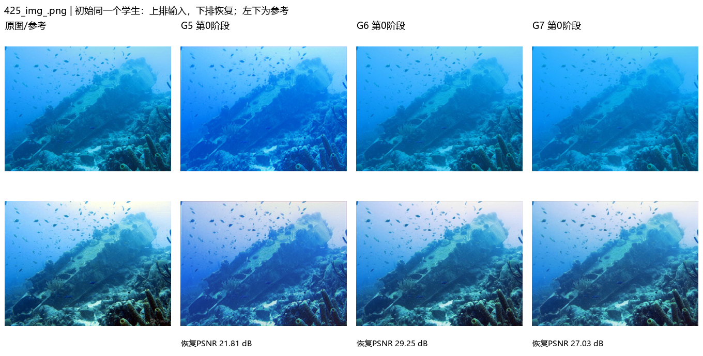
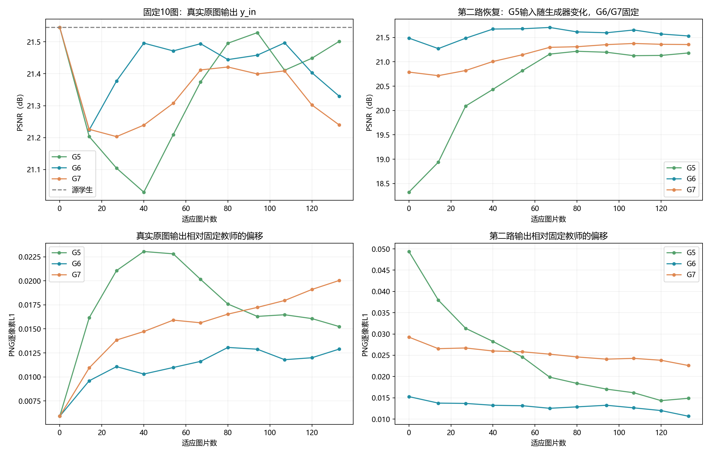

# 为什么物理方案弱于G5：中间结果对齐与机制复盘

日期：2026-10-14。继2026-10-13综合分析后，额外对齐G5/G6/G7同一10图、同一11阶段，核对RDDM实际监督方向，并补做冻结源学生的CPU离线诊断。本轮没有更新任何学生或新增正式TTA实验。

## 1. 结论与需要修正的解释

当前物理实现相对G5的最终目标PSNR低0.2851/0.3006 dB。现有证据支持“生成分布、跨图学习方式与学生更新需求不匹配”这一综合解释，尚不能把下降唯一归因于物理公式或过度退化。

更精确的判断：

- G6初始合成输入已经较容易被同一源学生恢复，明显好于G5初始第二路恢复；因此“物理输入一开始就更坏”不是完整解释。
- G5的生成器跨图持续学习，输入分布随阶段变化；这种变化单独就能改善冻结源学生的第二路结果。物理方案删除了这种跨图状态继承，不能视作只换了一个公式。
- 三组共享的学生目标直接约束第二路输出，没有直接把原图输出锚定到源状态。对物理输入执行相同学生更新强度，可能牺牲本来就较好的响应。
- G6更新后更接近教师、参数总移动更小，结果仍弱于G5；更新方向、逐图响应和伪标签质量比单纯“漂移量大”更重要。

仍需严格对照确认：上述几项各自贡献多少，改变学习率/生成器重置是否能消除差距，以及更小gamma是否有收益。

## 2. 中间结果在哪里、哪些文件对应

两组选择的是完全相同10张图，阶段为0、14、27、40、54、67、80、94、107、120、133。

程序机根目录F:\qmh\DCTTA-uie\experiments\UIEBblue_weaktostrong_NU2Net：

| 含义 | G5：_strength_v1/G5/images/ | G6/G7：_physical_v1/G6或G7/images/ |
|---|---|---|
| 固定教师伪标签 | teacher_pseudo/<stage>/<image> | teacher_pseudo/<stage>/<image> |
| 真正送入学生的第二路输入 | x_mix/<stage>/<image> | x_sd/<stage>/<image> |
| 第二路学生恢复y_sd | y_mix/<stage>/<image> | y_sd/<stage>/<image> |
| 原图学生恢复y_in | student_raw/<stage>/<image> | y_in/<stage>/<image> |

G5的x_sd是未混合的RDDM生成图，不是实际学生第二路输入；直接拿它与G6的x_sd比较会混淆强度。物理组training/<step>/保存真实训练图块raw、伪标签、x_sd、参数和201行拟合轨迹；G5真实图块的已保存统计在trajectory.json，没有同等完整的训练图块PNG/物理参数记录。

本次新增330张G5诊断输入/输出PNG的哈希核验，三组初始教师PNG一致。中间图保留原分辨率，联系表仅为显示缩小，不自动调色。统计颜色/L1来自PNG，应与真实训练浮点统计区分。

- [三组11阶段对齐曲线](g5_physical_comparison/aligned_intermediate_curves.png)
- [507图：三组真实原图恢复完整11阶段](g5_physical_comparison/507_yin_11_stages.png)
- [425图：初始同一学生的输入与恢复](g5_physical_comparison/initial_425_img_.png)
- [507图：初始输入与恢复](g5_physical_comparison/initial_507_img_.png)
- [78图：初始输入与恢复](g5_physical_comparison/initial_78_img_.png)

## 3. 一开始物理输入反而更容易恢复

固定10图、同一源学生、第0阶段：

| 指标 | G5 | G6 | G7 |
|---|---:|---:|---:|
| 原图y_in平均PSNR | 21.5448 | 21.5448 | 21.5448 |
| 第二路y_sd平均PSNR | 18.3227 | 21.4867 | 20.7885 |
| 第二路输出到教师的PNG L1 | 0.04938 | 0.01527 | 0.02926 |
| 第二路输入到raw的PNG L1 | 0.06345 | 0.02036 | 0.04093 |

这里“第0阶段”只指学生尚未更新：物理整图诊断已经完成该图200步拟合；G5只是从原初始RDDM EMA采样，没有额外对这些整图做同等拟合。因此生成器成熟度和预算并未匹配，不能把此表当作物理表达优于RDDM的纯结构比较。

G6的初始第二路恢复已接近原图源学生水平；G7也比G5第0阶段好。不能用最终排名反推物理生成输入在所有阶段都比RDDM差。

例如425图，第0阶段G5恢复21.8050 dB、G6恢复29.2495、G7恢复27.0259。物理公式在这张图上并不是一开始就无法给出可恢复输入。

## 4. G5的第二路改善，生成器变化贡献不可忽略

G5与物理方案的实质差异：

| 项目 | G5 | G6/G7 |
|---|---|---|
| 源教师 | 固定 | 固定 |
| 学生/Adam/Fisher与原损失 | 跨图累计，原协议 | 相同原协议 |
| 退化表示 | 条件残差扩散CNN | 3通道32网格T和3个全局B |
| 退化权重/优化器 | RAdam与权重跨图继承 | a/b和Adam每图从共同初态重置 |
| 生成器EMA | 跨图累计，用EMA采样 | 没有生成器EMA |
| 拟合 | 每图5次局部梯度更新，含随机扩散过程 | 每图200次直接L1+TV优化 |
| 固定图片阶段输入 | 生成器变化，x_mix变化 | 同一source/input拟合，x_sd固定 |

原RDDM代码实际data=[raw,pseudo]，p_losses把raw作为x_start、pseudo作为条件，训练退化关系；采样test(raw)又以raw为条件。物理方案也拟合J0→raw关系再施加到raw。因此“重复施加退化”是两种方案共有的使用方式，不能用它单独解释为什么物理更差。

源码位置：[RDDM实现](../../RDDM/src/residual_denoising_diffusion_pytorch.py)、[持久状态入口](../../RDDM/net.py)、[物理实现](../../physical_degradation.py)。此前效率讨论若把gradient_accumulate_every=2理解为每步两次反向，是不准确的：当前train只把loss除以2，没有两次累积循环；每图实际是5次前向/反向/更新，本轮没有更改这一原实现。

G5固定诊断采样种子在各阶段相同；10张x_mix第133阶段全部不同于第0阶段，平均输入L1变化0.06669。不是仅仅换了抽样种子。

为了分离学生变化，我额外保持源学生F0权重固定，对G5保存的输入PNG做CPU推理：

| 输入 | 冻结源学生F0的10图平均PSNR |
|---|---:|
| 原始raw | 21.5448 |
| G5第0阶段x_mix | 18.3073 |
| G5第133阶段x_mix | 20.6068 |

学生完全不学习，单独改变生成器阶段对应的输入，恢复就提升2.2995 dB。原运行的G5第二路提升为18.3227→21.1819（+2.8591）；不能把这2.8591全部算作学生学到的收益。

CPU raw预测与原CUDA第0阶段PSNR最大差2.1×10^-5 dB；在第0阶段x_mix上，因PNG量化和设备/版本差异，最大差0.0473 dB。该诊断显示固定模型对输入变化的响应，不替代正式CUDA浮点排名，不将2.30/2.86解释成精确的因果贡献百分比。冻结源学生对最终G5输入为20.6068，原适应学生为21.1819，约0.575 dB差值也只能作为辅助观察。

这提供了跨图生成器变化有实际作用的证据，但还没有证明G5最终真实raw收益中的哪一部分来自这种变化。若要分离，应增加专门的状态继承对照；逐图重置RDDM时还要处理EMA预热/采样时点，否则比较的是整套持久状态效应，不能声称只比较了网络结构。

## 5. 学生的两种输出在分叉

固定10图：

| 组别 | 第二路y_sd，第0→133步 | 原图y_in，第0→133步 |
|---|---:|---:|
| G5 | 18.3227→21.1819 | 21.5448→21.5014 |
| G6 | 21.4867→21.5310 | 21.5448→21.3295 |
| G7 | 20.7885→21.3546 | 21.5448→21.2395 |

物理第二路任务有所改善，真实输入输出却下降。G5固定10图最终也小幅下降，并非所有选图都受益；全133图G5则+0.2674。10张图按旧G0现象选定，不能取代总体评价。

原目标可简写为：

~~~text
L_s = loss(F_student(x_sd), stop_gradient(F_student(raw)))
L_t = 5 * loss(F_student(x_sd), fixed_source_teacher(raw))
L = L_s + L_t
~~~

两项梯度直接回传第二路输出；原图分支只提供当前值，不直接受到“保持源输出”的监督。共享参数改变后，真实raw响应会跟着变化。这个结构三组相同，物理输入改变了任务和梯度方向；它是可能的共同瓶颈，不是物理替代时新引入的代码错误。

但不能只按偏离教师大小解释G5/G6排名：最终10图y_in到教师L1为G5=0.01524、G6=0.01290、G7=0.02004。G6比G5更接近教师，PSNR仍低。因此更新方向和真实GT质量比“越接近伪标签越好”更重要。我们没有保存足够信息来测量每步L_s与L_t的梯度夹角，不能把损失冲突当作已证实的唯一根因。

## 6. 伪标签可能拉低本来较好的响应

425图提供了较明确的局部证据：

- 固定教师伪标签PSNR为28.7152 dB。
- G6第0阶段第二路恢复29.2495，已经高于教师；到133步降为28.5854。
- 同时，第二路输出到教师PNG L1从0.01366降至0.00966，一致性更好，真实参考质量却更低。
- 原图y_in从28.9096降至27.4300，下降1.4796 dB。

因此有些物理增强输入本来已被源学生较好恢复，继续逼近同一源教师伪标签并不必然改善它。固定10图初始第二路高于教师的数量为G5=1、G6=4、G7=2；G6其中一张只高0.0021 dB，不应作实质优势解读。以上涉及GT，仅用于事后诊断，不作为在线筛选条件。

这还不能证明整个模型下降都是教师目标造成的，因为其他图的第二路会改善，而且所有图的共享更新同时作用于425；但它反驳了“更一致就一定更接近正确增强”的假设。

## 7. 原学习率未必适合更容易的物理任务

第一张训练图完全相同，学生初态相同：

| 首次更新 | G5 | G6 | G7 |
|---|---:|---:|---:|
| total loss | 0.73713 | 0.16152 | 0.32502 |
| Adam后参数变化L2 | 0.35401 | 0.35405 | 0.35411 |
| Fisher恢复后变化L2 | 0.22377 | 0.22377 | 0.22382 |

G6 loss约为G5的22%，参数更新规模却几乎一样。Adam首步按二阶矩归一化，很多参数更新主要取决于梯度符号而非原始幅度，不能认为小loss自然意味着小更新。此处是实际首步记录，不将其外推为全部133步都相同。

最终模型到源权重距离G5=2.4131、G6=2.1316、G7=2.3224；G6总移动较小仍更差，也说明方向重要。两组物理直接沿用学生lr=2e-4和teacher_weight=5；它们适合原RDDM任务并不意味着对更容易的物理任务也恰好适合。

由此，除了改变输入gamma，较小学生学习率值得单变量检验。例如G6保持gamma=0.5、其他设置全不变，只把lr设为5e-5；这是建议预算而非已验证最优值。若同时改gamma和lr，就不能分辨哪一个起作用。

## 8. 为什么参数合法、拟合低误差仍不够

物理拟合I_hat=J0*T+(1-T)*B准确，只证明重建当前源候选与raw关系。它没有自动保证T/B是真实水体参数，也没有直接优化真实raw上的学生质量。

已观察到的局限：

- 全133图T红均值0.3325，G6/G7真实训练输入红色标准差平均只保留70.4%/42.1%；低红信号和低T分组更容易损害。但G5只保留63.4%而结果较好，过度压红不是单独充分解释。
- 当前T低分辨率、B每图三个全局值，只能表达逐像素、逐通道的衰减/背景混合。它不显式估计深度、不同直达/散射透射、传感噪声、模糊或跨通道耦合。不能因此断言目标数据确实需要这些因素，也不能宣称更复杂模型一定更好。
- J0来自NU2Net，含InstanceNorm和条件触发的逐通道min-max尾部归一化；它不是直接观测的物理场景辐射。固定源权重并不消除输出的上下文依赖。
- 同一78图patch B≈[0.0037,0.0119,0.0177]，full B≈[0.0042,0.7165,0.9896]；507图同一raw区域的full红T均值0.8321，patch独立拟合0.4566。说明参数显著依赖观察范围和源候选，不宜直接解释为裁剪无关的水体属性。

这些现象支持“物理启发的有效变换尚未与现有学生/图块训练协议匹配”，不支持“物理公式本身不合理”或“物理方法一般不如RDDM”的结论。

## 9. 为什么当前不能确定一个根因

可以排除：教师EMA误开启、Fisher保护失效、同图两组参数不同、正式训练偷偷读取GT、只有一张极端图片决定均值。

已有直接证据：生成器跨图状态方式不同；G5输入阶段变化单独可改变固定模型表现；G6初始第二路任务较容易；低loss没有对应更小首步更新；物理组第二路改善与真实输入漂移并存；个别样本更接近伪标签却远离GT。

仍属假设：物理模型表达不足是主因、跨图状态丢失解释大部分最终差距、学生学习率过大是主因、原图直接锚定一定有利。没有匹配消融不能精确分配这0.285/0.301 dB差距。

## 10. 后续实验优先级

若目的首先是找出“为什么比G5差”，应专门检验生成器状态继承；设计RDDM重置对照时必须统一/记录EMA预热、采样时点、初始化与噪声，避免不成熟EMA造成的伪对照。

若目的首先是改善物理方案，建议先用两个各自只改一项的对照区分输入与优化：

1. G6基础上只把gamma=0.5改为0.25，学生lr保持2e-4。
2. G6基础上gamma保持0.5，只把学生lr从2e-4降至5e-5。

保持200步物理拟合、固定教师、Fisher、顺序及全133图评价。不要把200步物理拟合的lr=0.05与学生lr混淆。若仍不足，再单独检验真实原图输出保持约束；不同时换生成参数化、数据子集和多个损失。

相较昨日仅优先建议更小gamma，本次补充证据提高了“学生更新强度”和“跨图生成器状态继承”检查的优先级。尚未实现或命名新正式组，不把建议写成已取得收益。

## 11. 数值证据

- [同图同阶段汇总](g5_physical_comparison/aligned_stage_means.csv)
- [330条逐图阶段统计](g5_physical_comparison/aligned_per_image_stages.csv)
- [10图逐项增益](g5_physical_comparison/selected_image_gains.csv)
- [教师质量与初始第二路](g5_physical_comparison/pseudo_label_quality.json)
- [冻结源学生诊断](g5_physical_comparison/frozen_source_g5_diagnostic.csv)、[诊断范围及校准](g5_physical_comparison/frozen_source_summary.json)

完整133图分布、损害尾部、颜色和时间统计仍见 [G6/G7综合分析](UIEB_BLUE_PHYSICAL_TTA_ANALYSIS.md)。本报告没有把10张诊断图当作独立测试集，也没有用GT确定任何已执行的在线停止或筛图规则。
