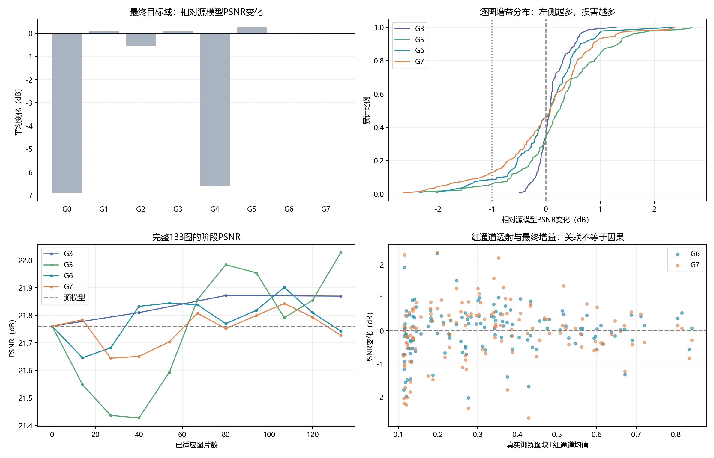
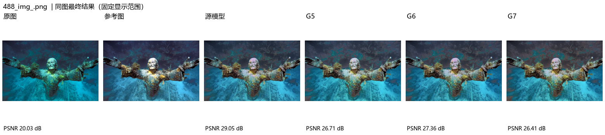
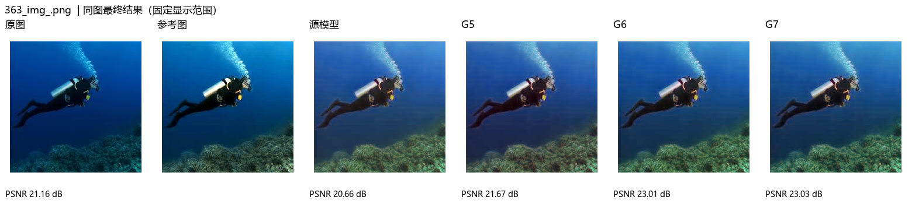
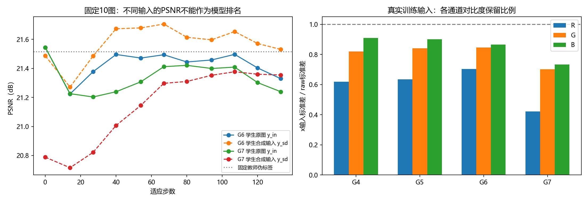

# G6/G7回传结果：综合分析与后续建议

日期：2026-10-13。实际目录：UIEBblue_weaktostrong_NU2Net_physical_v1。133张目标图、27张源验证图；固定源教师、逐图重置、200步拟合，G6 γ=0.5、G7 γ=1。本文把实测事实、机制推测和后续建议分开。

## 1. 结论

本轮验证了物理替代路径可运行、教师确实固定且参数重置正确，但没有取得优于现有G5的平均增强收益。G6/G7平均PSNR接近source_only，少量较大退化抵消了多数图片的小幅改善；完整强度增加了损害尾部和源域遗忘。G6的SSIM略有改善，不能因此宣布全指标优于原方法。

目前PSNR收益最好的既有工作参照仍是G5；G3提供更稳健的低损害参照。当前证据不支持继续增加物理拟合步数作为首选。下一步应先限制施加到已退化raw上的额外退化强度，并检查真实raw输出的保持。

## 2. 回传可信度

- G6/G7及比较状态均complete；验收passed，γ=0原G3第一步端点、恢复和观测隔离已在程序机通过。
- 独立核验2769个索引文件SHA256；1952张PNG齐全，目录实占1,744,092,672字节，约1.744 GB。
- 全部13个实现文件SHA与开发机当前代码一致。程序机Git提交和工作区记录为unavailable，不能凭HEAD溯源；可凭实际源码哈希确认实现身份。
- 133张对应图的G6/G7参数张量逐一完全一致，同一共同初态；10张预实验patch最终参数全部与正式训练匹配，10张full缓存也匹配预实验。
- 两组最终resume均cursor=steps=133，教师权重与保存的源权重完全一致。每组1,887,542个Fisher保护元素中，改变数为0。
- 两组固定10图的teacher_pseudo和x_sd在11阶段逐图文件哈希不变；排除教师EMA误开启或诊断生成器随学生漂移。
- 重算全部266张最终PNG相对本地reference的PSNR，与记录png_psnr最大差4.33×10^-7 dB。浮点输出指标与PNG量化指标没有混用。

核验依据：[audit.json](formal_analysis/audit.json)、[PNG核验](formal_analysis/png_verification.json)。核验最终冻结状态和已记录验收不等于对每一个历史GPU中间状态做了独立重放。

## 3. 与全部历史组对照

| 组别 | 教师与再退化 | 目标PSNR | 相对源模型 | SSIM | 下降>1 dB | 源验证PSNR变化 |
|---|---|---:|---:|---:|---:|---:|
| source_only | 源模型直接增强 | 21.7606 | 0 | 0.87792 | 0 | 0 |
| G0 | EMA教师 / RDDM完整 | 14.8646 | -6.8960 | 0.74566 | 129 | -5.4997 |
| G1 | 固定教师 / RDDM完整 | 21.8745 | +0.1139 | 0.87603 | 22 | -0.4994 |
| G2 | EMA教师 / 学生第二路raw | 21.2458 | -0.5148 | 0.87418 | 31 | -0.5205 |
| G3 | 固定教师 / 学生第二路raw | 21.8697 | +0.1090 | 0.87980 | 0 | -0.0007 |
| G4 | EMA教师 / RDDM混合0.5 | 15.1461 | -6.6145 | 0.76738 | 128 | -5.0514 |
| G5 | 固定教师 / RDDM混合0.5 | 22.0280 | +0.2674 | 0.87877 | 7 | -0.0741 |
| G6 | 固定教师 / 物理200步 γ=0.5 | 21.7429 | -0.0177 | 0.87963 | 11 | -0.0591 |
| G7 | 固定教师 / 物理200步 γ=1 | 21.7274 | -0.0332 | 0.87785 | 17 | -0.1807 |

所有PSNR均为学生对完整真实raw输入的最终评价；第二路raw组仍在旧实现中运行RDDM但不使用其生成输入。指标并不表示原论文的独立公开benchmark。

相对G5，G6低0.2851 dB（50张胜、83张负），G7低0.3006 dB（44张胜、89张负）。逐图配对bootstrap 10,000次的均值差95%区间分别为[-0.3879,-0.1830]和[-0.4039,-0.1985] dB，说明本次数据与顺序下的差距不只是平均数被一张异常图改变。

G6/G7相对source_only的bootstrap区间都跨0；二者之间的平均差仅-0.0156 dB，区间[-0.0908,+0.0592]跨0。因此不能断言完整强度在所有图片或平均PSNR上必然更差；可以明确说其较大损害更多、SSIM及源验证保持更差。区间只描述当前单次固定顺序的数据重采样，不覆盖顺序/随机种子/新域泛化的不确定性。

## 4. 少数较大退化抵消收益

G6/G7均72张改善、61张下降，中位增益分别+0.0725/+0.0819 dB，但均值为负。G6的11张下降超过1 dB的图片累计损失17.1665 dB；其余122张平均+0.1214 dB。G7对应17张累计损失28.7369 dB，其余116张平均+0.2096 dB。上述剔除统计仅解释均值，不是允许删除难例后的正式结果。

G6的11张大幅损害图全部包含在G7的17张之内。最严重的共同难例包括：

| 图片 | source PSNR | G5增益 | G6增益 | G7增益 |
|---|---:|---:|---:|---:|
| 488_img_.png | 29.0459 | -2.3334 | -1.6813 | -2.6388 |
| 466_img_.png | 28.0294 | -1.4723 | -2.0286 | -2.3340 |
| 549_img_.png | 25.3964 | -2.2396 | -1.9702 | -2.2322 |
| 8056.png | 21.3247 | -0.7116 | -1.7840 | -2.0448 |

有的损害三种生成方案都存在，说明剩余问题不专属于物理模型；有的在物理方案更明显。需要区分公共学生目标/参数漂移与生成形式的作用。

363_img_.png则是有效改善案例：source=20.6586，G5=21.6683，G6=23.0066，G7=23.0348。物理方案不是对所有图失效；问题在于收益分布和受损尾部。

## 5. 硬截断减少，但红色信息预算仍过小

下表统计实际参与训练的133张确定性图块，每张图等权；比例来自浮点值而非PNG。G5列为实际送入学生的混合输入。

| 实际输入 | 红通道标准差/raw | 红通道精确0占比 | 红通道低于1/255占比 |
|---|---:|---:|---:|
| raw | 1.0000 | 16.15% | 16.15% |
| G5 RDDM混合0.5 | 0.6344 | 16.04% | 25.84%（旧near_zero为≤阈值） |
| G6 物理γ=0.5 | 0.7039 | 0 | 19.75% |
| G7 物理γ=1 | 0.4215 | 0 | 22.47% |

旧统计使用≤1/255，新统计使用<1/255，近零比例不能作为完全相同阈值的严格差异检验；精确0与标准差比例定义可比。G7红色标准差保留比例中位0.4183，最差0.1116；G6最差0.5507。

T红通道均值为0.3325，绿/蓝为0.6560/0.6793。每图红色T<0.12的面积比例平均23.11%，T<0.15平均36.11%；这仍是明显的额外红色压缩。T本身是拟合的有效参数，不是真实水体透射标签。

精确0消失部分来自B=sigmoid(b)>0：原来已为0的像素也得到小正数，但小正数不能恢复丢失的红色结构。更关键的是：G6的红色对比度保留和精确0统计优于G5，平均增强结果仍弱于G5。由此不能把“生成红通道硬截断”作为负迁移的完整解释，生成输入与原学生任务是否匹配同样关键。跨G5/G6还改变了生成形式、逐图重置和拟合预算，不能单独归因给某一个统计指标。

最终浮点红通道MAE为source 0.09145、G5 0.09089、G6 0.09270、G7 0.09491；G6/G7绿蓝MAE有所改善，红色误差则增加。这支持“颜色恢复尤其红色仍是短板”，而不是全通道一起灾难性崩溃。

## 6. 拟合成功不代表训练增强成功

真实133图平均重建L1：0步0.12911、50步0.05826、100步0.02489、200步0.01083；从初态下降91.6%，100→200继续下降56.5%。133张200步误差均小于100步；但49张在最后25步相对变化仍超过10%，200是固定预算，不是全部达到收敛。

低L1说明对(J0,raw)关系的重建更充分，未证明生成了有用的额外退化，更未证明识别了真实T/B。令r=J0*T+(1-T)*B-raw，则严格有：

~~~text
x_sd - raw = gamma * [T * (raw - J0) + r]
~~~

重建残差小以后，施加到raw上的改动主要沿着raw相对源候选J0的差异继续推进。源候选本身的颜色/内容误差也可能被参数吸收。若raw本来就缺红，继续对raw应用相同衰减关系可能制造信息更少的输入；这正是“重建拟合”与“TTA有益增强”两个目标之间的区别。

整体loss均值G6=0.2413，低于G5=0.3793，但增强结果更差；G7=0.5251。不同生成输入改变任务难度，不能只按训练loss大小选择方案。当前尚未运行100步的正式TTA，不能根据200步最终收益不足推断100步一定更好。

## 7. 学生在合成域改善，真实输入输出却漂移

固定10图中，G7的y_sd PSNR由20.7885升至21.3546（+0.5661），y_in却从21.5448降至21.2395（-0.3053）。G6对应y_sd +0.0443、y_in -0.2154 dB。

相对固定教师PNG的逐像素L1（仅整图诊断，不是训练loss）：

| 组别 | 合成输入y_sd：第0→133步 | 原图y_in：第0→133步 |
|---|---:|---:|
| G6 | 0.01527→0.01067 | 0.00591→0.01290 |
| G7 | 0.02926→0.02258 | 0.00591→0.02004 |

教师始终固定，学生对合成输入更接近教师，对真实原图却更远。结合原raw分支停止梯度、loss_t只直接监督y_sd的结构，这支持“合成任务的拟合没有充分迁移到原输入，甚至改变了原输入的响应”这一机制。它是证据支持的解释，不是对所有图的唯一因果证明。

图中G6蓝实线/G7绿实线是y_in，G6橙虚线/G7红虚线是y_sd。不同输入的曲线用于看各自变化，不能据此给模型直接排名。

固定10图和原12张目标探针由旧G0现象选定，不代表全133图均值：12张探针的总变化G6=-0.3694、G7=-0.4723，而全目标为-0.0177/-0.0332。G6有70次、G7有81次更新使这12张探针均值下降；这也不等于每次全133图均值都下降。

## 8. 阶段走势与裁剪上下文

全133图的G6阶段最高记录在107步：21.9014，相对source +0.1408 dB；结束为21.7429。G7的107步为21.8429，结束21.7274。二者不像G0单调崩溃，而是小幅起伏，后期收益回落。107步只是11个观察点中的事后最佳点，不能用目标reference选它作为无监督在线停止规则；也没有证据支持简单增加适应步数。

整图诊断与训练patch的T/B相差明显。10张图B的平均绝对差为0.1314。78_img_.png：patch B≈[0.0037,0.0119,0.0177]，full B≈[0.0042,0.7165,0.9896]。507图相同raw坐标区域的full T红均值0.8321，而独立patch T红均值0.4566。

这说明参数显著受源候选的上下文和拟合可辨识性影响；不能把它们直接解释为已恢复了与裁剪无关的真实水体参数。此处整图参数从来没有替代训练图块，代码上不存在偷偷混用；但研究层面需要检查patch训练与整图推理的不一致。

## 9. 哪些图更容易受损

事后四分位分析：

- raw参考PSNR最低34张：G6=-0.3273、G7=-0.2936 dB，G5=+0.1877。
- 训练图块红色均值最低34张：G6=-0.2922、G7=-0.4039，G5=+0.1589。
- T红均值最低34张：G6=-0.3001、G7=-0.4771，G5=+0.1609。
- 源模型相对raw提升最大的33张：G6=-0.5193、G7=-0.4869，G5=+0.1405。

源模型对原图已经提供了较大恢复的区域，物理额外退化可能再次压缩本来就弱的信号。全体Spearman关联并不强：T红均值与最终收益仅约0.137/0.130；当前图T红与当次探针变化约0.190/0.204。因此不能只按一个T阈值宣称已经定位全部根因。

raw PSNR和源提升量用到了reference，以上仅用于事后分析，不能用作在线选图/停止条件。源提升量(source−raw)和适应增益(final−source)还共享source项，存在数学耦合，不能把其负相关直接解释为因果；已表现很好的图也可能有改善空间较小等混杂。像素数量相关性较弱，也不支持把大图分辨率视为负效果唯一原因。详细分层：[heterogeneity.json](formal_analysis/heterogeneity.json)。

## 10. 实际效率

| 每张训练图块，平均秒 | G6 | G7 |
|---|---:|---:|
| 固定教师八视图 | 0.303 | 0.315 |
| 200步拟合及最终生成 | 0.924 | 0.930 |
| 输入/参数统计 | 0.922 | 0.925 |
| 学生更新及只读摘要 | 0.306 | 0.308 |
| 上述适应总计 | 2.455 | 2.477 |
| 训练图块导出 | 0.815 | 1.461 |
| 离线观测及导出 | 21.588 | 22.437 |

133图的200步拟合合计约123秒/组，适应主体约5.44/5.49分钟。已记录观测耗时约47.85/49.74分钟，约占“适应+训练导出+观测”分项总和的86.8%/85.1%。分项没有覆盖第0阶段、验收、原子断点保存及重复预检，不能当作完整墙钟时间。

之前预实验patch约9.41秒/图包括教师、6个拟合阶段的统计和图片导出；现在0.924秒只计200步拟合与最终生成，范围不同。原RDDM的28.27秒也包含不同的诊断/权重保存，仍不能给出公平的纯RDDM加速倍数。已经可以确认当前低维拟合成本较低，正式诊断运行的主要耗时在观测和IO。G7导出更慢而拟合耗时接近G6，不应把额外导出耗时归因于γ增加计算量。

## 11. 更新后的问题判断和建议

已支持的判断：固定教师消除了原有反馈链的灾难性放大；仅减少红色硬0不足以获得更好增强；增加γ扩大损害尾部；合成输入任务与真实raw输出之间存在收益不一致。尚未确定的问题：T/B的物理真实性、预算100/200的TTA质量差异、裁剪上下文究竟贡献多少、损失各分量的梯度方向，以及不同顺序是否改变这些结论。

优先下一步建议仍保留全部133图作评价，固定教师、学生损失、Fisher、200步拟合和顺序：

1. 先比较更小固定强度γ=0.25，隔离“拟合关系很好但额外退化太强”的问题；与G6及G3对照。不先增加拟合步数。
2. 再比较只基于当前raw/T/B的输入信息保护策略：例如选择不超过0.5的强度，并限制生成红通道标准差相对raw的损失。红色保留0.8可作为待验的工程起点，不是本次结果证明的最佳阈值；退化不能满足条件时弱化或回退raw，评价集仍保持133图。

不优先只挑“更强退化图”重建数据集：当前最弱红信号/低raw PSNR分组恰好更容易损害，直接保留这些图未必改善更新。若将来做训练子集对照，仍对全部133图评价，并用不含reference的预先规则选图。

如果弱强度或输入保护仍不能超过G3，下一步再单独检查raw分支保持约束或patch/full上下文；不要同时改多个损失、参数化和数据子集。本报告仅给建议，没有新增实验入口或替用户确定新的超参数。

G5继续作为当前开发集的PSNR参照，G3作为稳健参照。方法和阈值确认后仍需要未参与方案选择的数据及新的固定顺序做同顺序对照。本轮结果不能直接外推为所有水下场景或原论文方法的优劣。

## 12. 证据入口

- [逐图增益与属性](formal_analysis/target_paired_features.csv)
- [真实训练T/B参数统计](formal_analysis/physical_parameters.csv)
- [拟合预算和收敛变化](formal_analysis/fit_convergence.csv)
- [源监督、颜色和上下文机制统计](formal_analysis/mechanism_analysis.json)
- [阶段完整评价](formal_analysis/full_stage_curves.csv)
- [G6逐步探针变化](formal_analysis/G6_probe_updates.csv)、[G7逐步探针变化](formal_analysis/G7_probe_updates.csv)
- [分项耗时和损失](formal_analysis/timing_and_losses.json)

分析报告与精选小型证据独立进入Git；实验目录、恢复状态、参数权重和全量图像不加入Git。

后续补充（2026-10-14）：[G5与物理方案中间结果及机制深挖](UIEB_BLUE_G5_PHYSICAL_MECHANISM_ANALYSIS.md)新增冻结源学生诊断，区分G5生成器变化与学生学习，指出低loss仍可能有相似首步更新，并提高学习率单变量对照的检查优先级。
